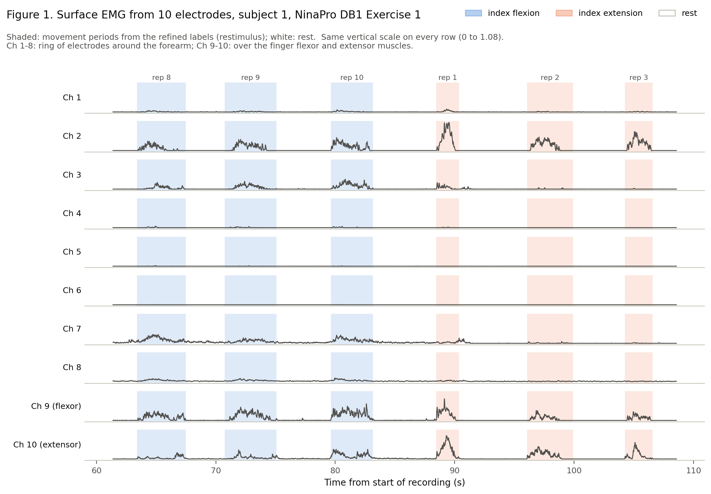
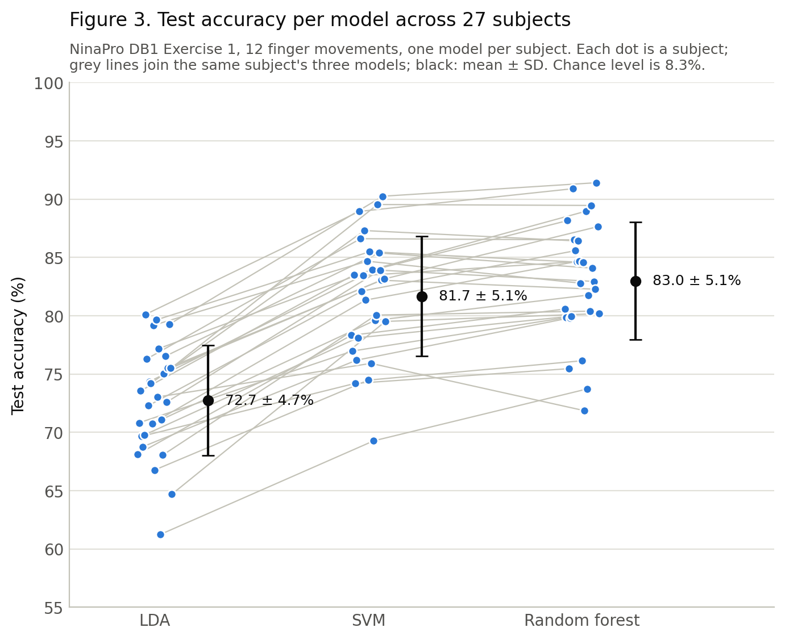
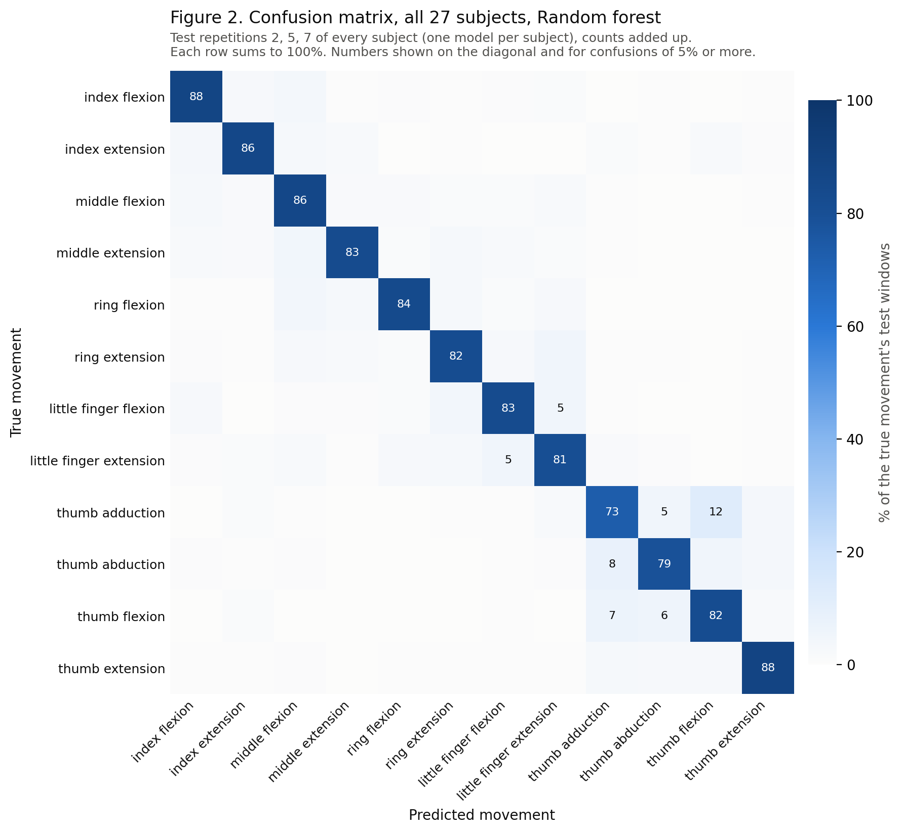
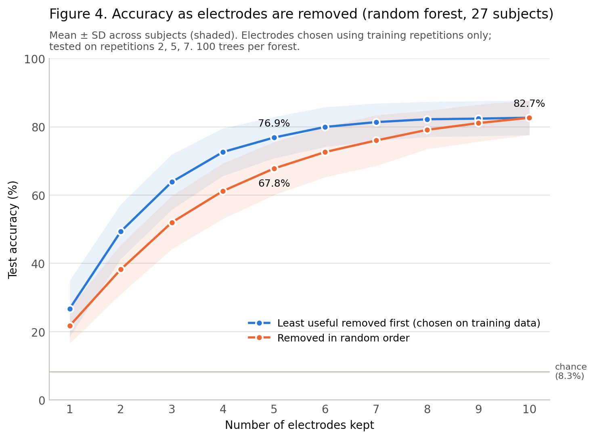

# Decoding hand movements from muscle signals

**Classifying 12 finger movements from 10-channel forearm surface EMG (NinaPro DB1, 27 people), and testing how many electrodes are really needed.**

[](https://colab.research.google.com/github/PMartynov60/semg-finger-movement-decoding/blob/main/semg_finger_decoding.ipynb)

## Summary

- **Accuracy.** A random forest trained separately for each person recognised the 12 finger movements with **83.0 ± 5.1%** accuracy on repetitions it had never seen (mean ± SD over 27 people; chance is 8.3%). SVM reached 81.7 ± 5.1% and LDA 72.7 ± 4.7%.  
- **Electrodes.** Six well-chosen electrodes kept **80.0%** accuracy, against 82.7% with all ten (same 100-tree forest). Six electrodes chosen at random fell to 72.6%: placement matters, not just the number.  
- **Hardest movements.** Errors cluster in the thumb. Thumb adduction was recognised least often (72.8%) and was most often mistaken for thumb flexion.  
- **Honest testing.** Models are always tested on repetitions they never saw. For one subject, a random split would have put 99.6% of test windows next to a training window sharing the same raw samples; the repetition split puts 0%.

## The question

Myoelectric hand prostheses are controlled by the electrical activity of the user's forearm muscles, and pattern-recognition control tries to recognise the intended movement from several surface electrodes. On a public benchmark dataset, this project asks:

1. How accurately can 12 individual finger movements be recognised from 10 forearm electrodes with classic features and classifiers, using one model per person?  
2. How does accuracy change as electrodes are removed, and does it matter which ones are kept?

## Data

[NinaPro DB1](https://ninapro.hevs.ch/instructions/DB1.html) (Atzori et al., 2014): 27 intact subjects recorded with 10 Otto Bock MyoBock 13E200 electrodes. Eight are equally spaced around the forearm at the height of the radio-humeral joint, and two sit over the main activity spots of the finger flexor and extensor muscles. The electrodes output an amplified, band-pass-filtered, RMS-rectified signal, recorded at 100 Hz.

This project uses Exercise 1: 12 finger movements (flexion and extension of the index, middle, ring and little fingers; thumb adduction, abduction, flexion and extension), each repeated 10 times as about 5 s of movement followed by 3 s of rest. Labels are the refined `restimulus` and `rerepetition` variables, which were realigned offline to the actual movement.

**The data are not included in this repository.** The NinaPro site does not state a licence for redistribution, so the notebook downloads the files from the official site. If you use the data, please cite the NinaPro papers listed below.



*Figure 1\. Ten EMG channels from subject 1 during the last three repetitions of index flexion (blue) and the first three of index extension (orange). Flexion mainly activates the electrode over the finger flexors (Ch 9\) with Ch 2, 3 and 7; extension mainly activates the electrode over the finger extensors (Ch 10\) and Ch 2\. Both targeted electrodes respond to both movements, so the movements are told apart by the pattern across electrodes.*

## Method

| Step | Choice | Why |
| :---- | :---- | :---- |
| Windows | 200 ms (20 samples) every 50 ms; only windows lying entirely inside one repetition of one movement; rest excluded (added back in the extension) | 200 ms is the NinaPro benchmark window length |
| Features | Per electrode: mean absolute value, RMS, waveform length and standard deviation (40 features) | Zero crossings and slope sign changes describe the frequency content of raw EMG; DB1's signal is already a rectified envelope that never crosses zero |
| Split | Train on repetitions 1, 3, 4, 6, 8, 9, 10; test on 2, 5, 7 | The NinaPro benchmark split. Overlapping windows make random splits leak (Result 4\) |
| Models | LDA; SVM (RBF kernel, C \= 1, gamma \= "scale"); random forest (300 trees). Default settings, each inside a scikit-learn `Pipeline` with a `StandardScaler` | The scaler is fitted on training windows only |
| One model per person | Each subject's models are trained and tested on that subject's data alone | Muscle signals differ between people |
| Evaluation | Window-level test accuracy per subject; mean ± SD over the 27 subjects; paired Wilcoxon signed-rank tests between models (threshold 0.05 / 3 for three comparisons) | Every subject is tested with every model |

All random steps use seed 42, and the exact package versions are in `requirements.txt` (Python 3.13).

## Results

### 1\. Accuracy across 27 subjects (12 movements, rest excluded)

| Model | Test accuracy (mean ± SD) | Range across subjects |
| :---- | :---- | :---- |
| LDA | 72.7 ± 4.7% | 61.2–80.1% |
| SVM | 81.7 ± 5.1% | 69.3–90.2% |
| **Random forest** | **83.0 ± 5.1%** | 71.9–91.4% |



- **Random forest vs SVM:** \+1.3 points on average (SD 2.3), better for 18 of 27 subjects, Wilcoxon p \= 0.007. The lead is small but consistent.  
- **Both beat LDA clearly:** the random forest by 10.3 points (26 of 27 subjects, p \= 3 × 10⁻⁸) and SVM by 8.9 points (27 of 27, p \= 1.5 × 10⁻⁸).  
- **People differ more than models do.** With the same recipe, the random forest scored from 71.9% to 91.4% depending on the person.  
- **Speed (subject 1, free Colab, batch timing):** prediction took about 9 µs per window for LDA, 59 µs for the random forest and 951 µs for SVM. All are far below the 50 ms between windows, but the difference could matter on a small embedded controller.

### 2\. Which movements are confused?



Per-movement accuracy (random forest, all subjects pooled) ranged from 72.8% (thumb adduction) to 88.0% (thumb extension). Six of the eight most common confusions are among thumb adduction, abduction and flexion; the largest is thumb adduction read as thumb flexion (12.3%). A plausible explanation is anatomical: thumb adduction relies on adductor pollicis, a muscle inside the hand that forearm electrodes see only indirectly, whereas thumb extension is driven by extensor pollicis longus in the forearm. A middle/ring-finger confusion seen in subject 1 did not hold across subjects.

### 3\. How many electrodes are needed?



Starting from all ten electrodes, a random forest (100 trees) was trained on the training repetitions, the electrode with the lowest summed feature importance was removed, and the forest was retrained, down to one electrode. Test accuracy was recorded at each step; the test repetitions were never used to choose electrodes. As a baseline, electrodes were also removed in one fixed random order per subject.

| Electrodes kept | 10 | 8 | 6 | 5 | 4 | 3 | 2 | 1 |
| :---- | :---- | :---- | :---- | :---- | :---- | :---- | :---- | :---- |
| Least useful removed first (%) | 82.7 | 82.2 | 80.0 | 76.9 | 72.6 | 63.9 | 49.3 | 26.8 |
| Random order (%) | 82.7 | 79.1 | 72.6 | 67.8 | 61.2 | 52.0 | 38.2 | 21.7 |

- Removing the four least useful electrodes cost 2.7 points. Below five electrodes, accuracy fell quickly.  
- Choosing well matters most with 3–4 electrodes left, where the gap to random removal was 11–12 points.  
- Ch 5 was removed first for 17 of 27 subjects and was never among anyone's last three. Ch 7 (18 of 27 subjects), Ch 8 (14) and Ch 10, over the finger extensors (12), were most often among the last three kept.  
- Ch 9, over the finger flexors, ranked only fourth from the bottom (average removal position 5.6 of 10). "Removed early" means "least needed given the electrodes still there", not "uninformative": its information may overlap with neighbouring electrodes.  
- Before the experiment I predicted, from signal amplitude, that Ch 5 and Ch 8 would be least useful for subject 1\. Ch 5 was indeed removed first, but Ch 8 was that subject's most useful electrode: a loud electrode is not necessarily an informative one.  
- Using 100 trees instead of 300 cost 0.3 points with all ten electrodes (82.7% vs 83.0%).

### 4\. Why the split matters

Neighbouring 200 ms windows taken every 50 ms share 150 ms of signal. For subject 1, a random split of the windows (same 31% test share) put 99.6% of test windows next to a training window containing some of the same raw samples. Holding out whole repetitions put 0.0%, and it tests the model on a new attempt at each movement, which is what a prosthesis user makes every time they move.

### 5\. Extension: adding rest back in (13 classes)

Each rest period was attached to the repetition just before it, so rest could be split by repetition too.

| Model | Accuracy | Balanced accuracy | Rest read as movement | Movement read as rest |
| :---- | :---- | :---- | :---- | :---- |
| Always "rest" | 56.5 ± 6.2% | 7.7 ± 0.0% | 0.0% | 100.0% |
| Random forest | 84.9 ± 5.4% | 75.1 ± 5.6% | 5.9 ± 4.6% | 16.7 ± 5.7% |
| Random forest, class-balanced | 84.8 ± 5.3% | 73.8 ± 5.8% | 4.8 ± 3.9% | 19.0 ± 6.3% |

Rest made up 45–66% of windows, so plain accuracy is misleading: a model that always answers "rest" scores 56.5%. Balanced accuracy, the average of the 13 per-class accuracies, is the honest measure. Class weighting did not improve it; it traded false movements for missed ones. A likely reason is that the fully grown trees end in single-class leaves, so class weights mainly change where the trees split rather than how the leaves vote.

## Comparison with published results

- **Similar 12-movement task:** the dataset authors classified a 12-movement set from DB1 (10 of these finger movements plus two movements from Exercise 2\) with an SVM, time-domain features and leave-one-out testing, reporting 82.77 ± 9.27% (Atzori et al., 2014). The SVM here reached 81.7 ± 5.1%. The results are consistent, although the movements, features and testing scheme differ.  
- **Full benchmark:** for all 52 movements plus rest (53 classes), the NinaPro benchmark is 75.32 ± 5.69% (random forest, all features; Atzori et al., 2016). That is not comparable with 83.0% here: 12 classes instead of 53 (chance 8.3% vs 1.9%) and no rest class. In both, the random forest was the best classical model.

## Limitations

- **Intact subjects, not amputees.** After a below-elbow amputation the muscles inside the hand are gone, so the thumb results in particular may not transfer.  
- **Offline, window-level accuracy, not real-time control.** There is no decision smoothing or delay analysis, and windows that straddle a movement's start or end were excluded, which flatters accuracy.  
- **One model per person, one session.** New users, electrode shifts between days and a shared electrode layout across people were not tested.  
- **Simple modelling choices.** Default hyperparameters, a greedy electrode search, and 100-tree forests in the electrode and rest experiments.  
- **Rectified 100 Hz signal.** Methods designed for raw EMG (such as frequency features) cannot be tested on DB1.

## Next steps

Amputee data (NinaPro DB3); cross-subject models; hyperparameter tuning with repetition-grouped cross-validation; one electrode layout chosen across subjects; real-time metrics with decision smoothing; adjusting the decision threshold for rest.

## How to run

- **Google Colab (recommended):** click *Open in Colab*, then *Runtime → Run all*. Allow Google Drive access when asked (data and results are stored there), or set `USE_DRIVE = False` in cell 0.1 to keep everything in the temporary session. The notebook downloads about 635 MB from the NinaPro site and keeps only the Exercise 1 files (about 100 MB). A full run from scratch takes about 45 minutes on the free tier. Results are saved in `results/` and reloaded on later runs; set `RERUN`, `RERUN_ELECTRODES` or `RERUN_REST` to `True` to recompute them.  
- **Locally:** with Python 3.13, run `pip install -r requirements.txt`, then open the notebook in Jupyter. Data, figures and results are written next to the notebook.

## Repository contents

```
semg_finger_decoding.ipynb   full analysis, with outputs
requirements.txt             exact package versions
figures/                     Figures 1-4, plus subject 1's confusion matrix
results/                     per-subject results (CSV) and summed confusion counts
LICENSE                      MIT licence (code only)
```

## References

1. Atzori M. et al. (2014). Electromyography data for non-invasive naturally-controlled robotic hand prostheses. *Scientific Data* 1, 140053\. [doi:10.1038/sdata.2014.53](https://doi.org/10.1038/sdata.2014.53)  
2. Atzori M. et al. (2015). Characterization of a benchmark database for myoelectric movement classification. *IEEE Transactions on Neural Systems and Rehabilitation Engineering* 23(1), 73–83. [doi:10.1109/TNSRE.2014.2328495](https://doi.org/10.1109/TNSRE.2014.2328495)  
3. Atzori M. et al. (2012). Building the NINAPRO database: a resource for the biorobotics community. *Proceedings of IEEE BioRob 2012*.  
4. Atzori M., Cognolato M. & Müller H. (2016). Deep learning with convolutional neural networks applied to electromyography data: a resource for the classification of movements for prosthetic hands. *Frontiers in Neurorobotics* 10, 9\. [doi:10.3389/fnbot.2016.00009](https://doi.org/10.3389/fnbot.2016.00009)  
5. Phinyomark A., Limsakul C. & Phukpattaranont P. (2009). A novel feature extraction for robust EMG pattern recognition. [arXiv:0912.3973](https://arxiv.org/abs/0912.3973)

## Licence

The code is released under the MIT licence (see `LICENSE`). The NinaPro data belong to their authors and are not redistributed here.

## Author and acknowledgements

PMartynov60, third-year Human Genetics student at Trinity College Dublin. 